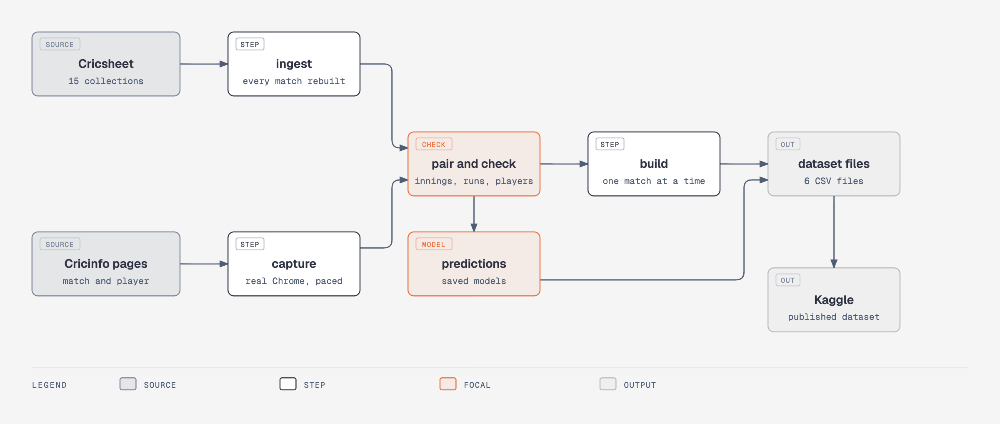
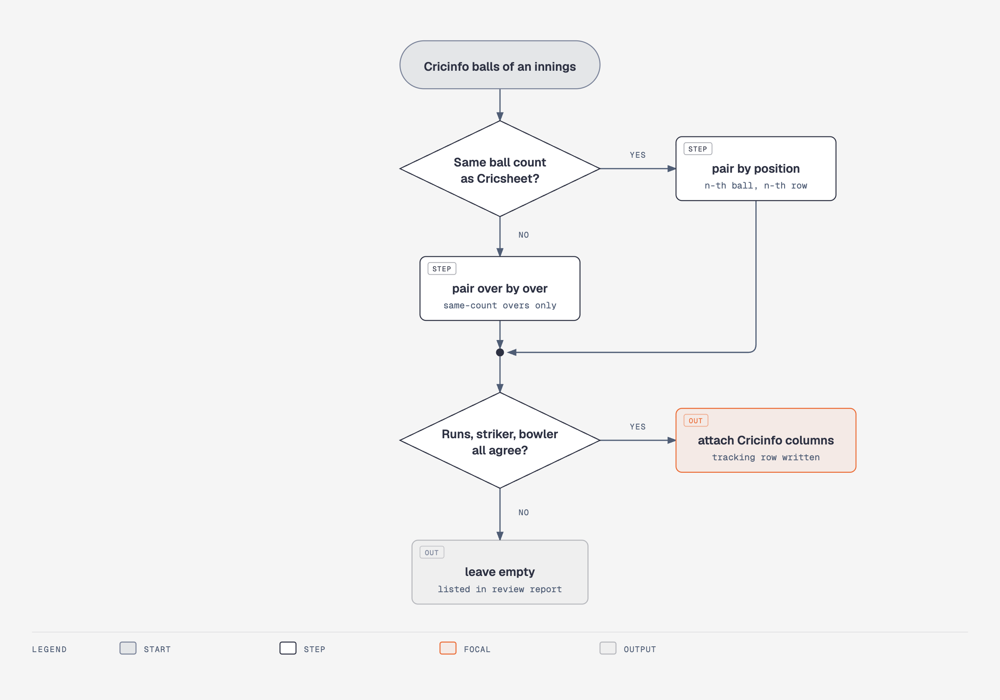
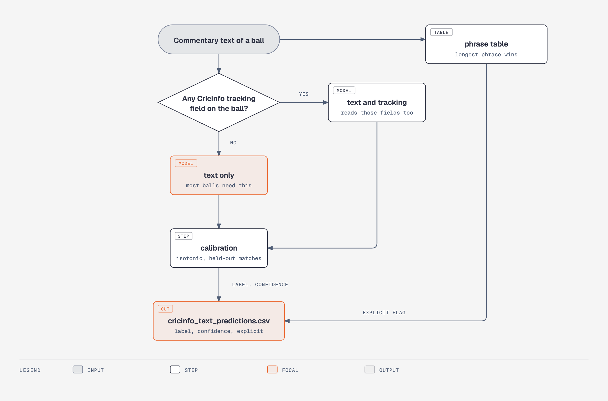

# Architecture

The pipeline rebuilds the dataset from two sources. Cricsheet is the base. Cricinfo adds tracking data to the balls it covers. Each stage reads files from the one before and writes its own, so any stage can be rerun alone. The decisions behind it are in [design_decisions.md](design_decisions.md).

## The pipeline

The Cricsheet side needs no scraping and runs in minutes. The Cricinfo side is the slow part: a full capture of about 14,500 matches takes days. Capture drives a normal Chrome, paces its requests, and saves what it reads to disk so a stopped run resumes where it left off.

## Pairing a Cricinfo innings with Cricsheet

Cricsheet is the base for position, runs, extras and wickets. A Cricinfo ball is attached to a Cricsheet row only if it passes every check, so a wrong pairing leaves empty cells and never a wrong value. Cricinfo sometimes leaves whole overs out of its commentary, often every second over. Pairing over by over keeps the overs it has, and only the missing ones stay empty.

## How a prediction is made

Most balls that need a prediction have no tracking field, so the text-only model handles them. Direction has an extra "none" class so the model can decline a ball that was not hit. Details are in [predictions_file.md](predictions_file.md).

## Where things live

| Folder | Holds |
|---|---|
| `cricket_pipeline/` | the pipeline: ingest, capture, pair, build, verify |
| `analysis/` | the predictions generator, its checks, the phrase table and its audits. Earlier experiments are in `analysis/archive/` |
| `tests/` | tests for pairing, the wagon wheel maths, the build and the phrase table |
| `docs/` | these pages. The diagrams are in `docs/diagrams`, as HTML and PNG |
| `data/` | every captured and built file, kept out of git |
